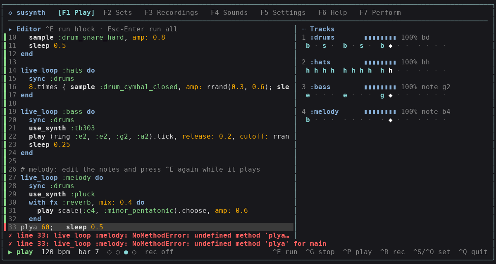
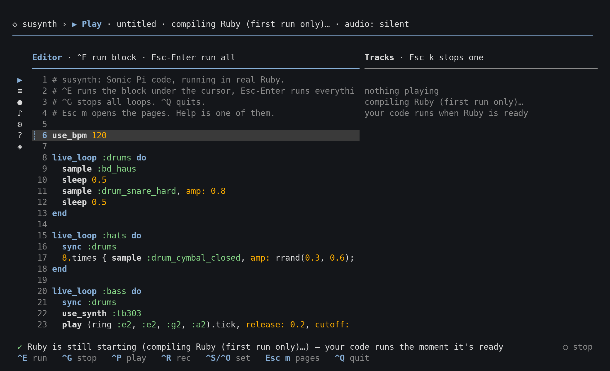
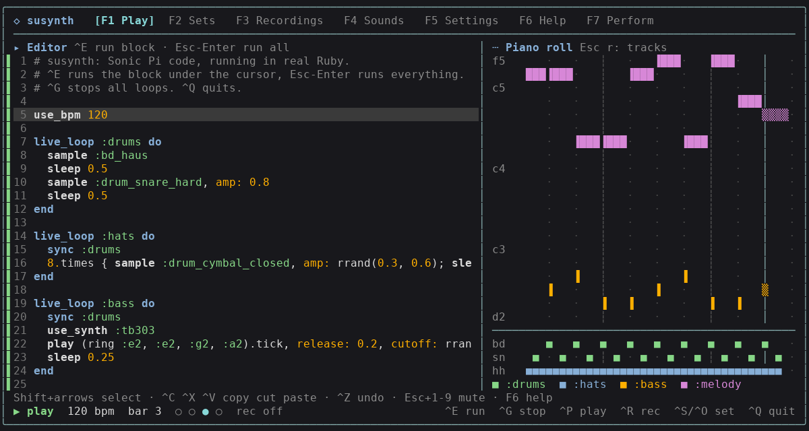
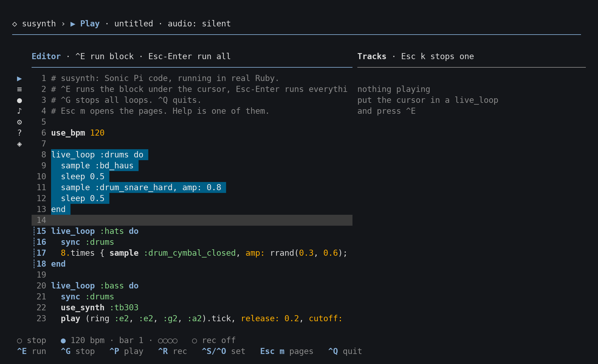
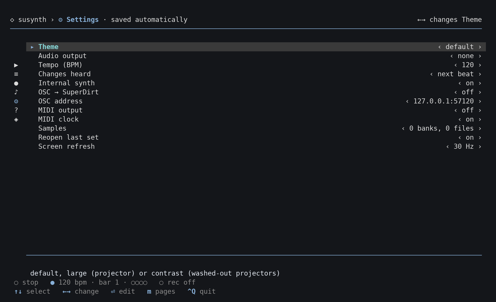
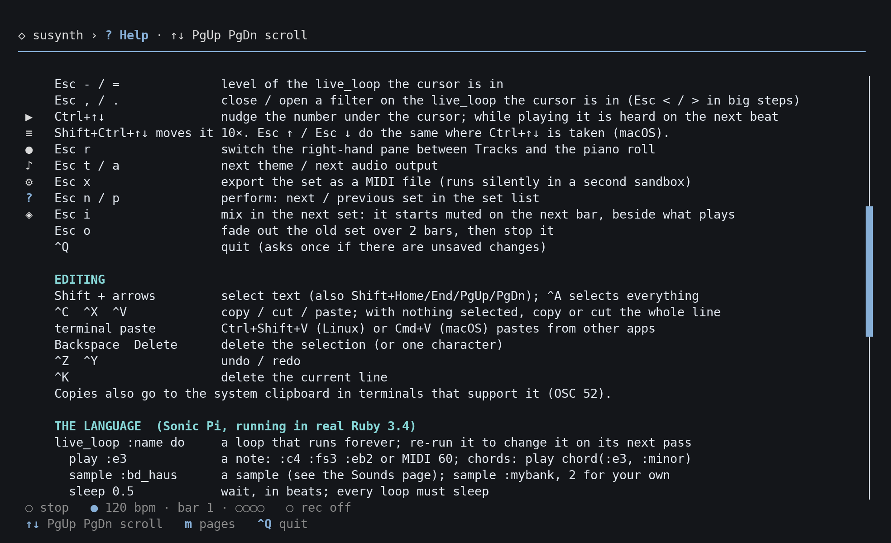

# susynth

A terminal instrument for live-coding music in **Sonic Pi's language**. You write
`live_loop`s in an editor pane, press `^E`, and hear the change on the loop's next
pass. One standalone Go binary: no cgo, no Ruby to install, no external player programs.

It **plays Sonic Pi code you find online**, with **Sonic Pi's real samples** and its
**moving effects** (`slicer`, `wobble`, `flanger`, …): all 34 example songs that ship with
Sonic Pi play with nothing left out. See [Playing Sonic Pi code](#playing-sonic-pi-code).

**Install:** `curl -fsSL https://raw.githubusercontent.com/CurtisD4q/susynth/main/install.sh | sh` (Linux and macOS; [more ways below](#install)).

```ruby
use_bpm 120

live_loop :drums do
  sample :bd_haus
  sleep 0.5
  sample :drum_snare_hard, amp: 0.8
  sleep 0.5
end

live_loop :bass do
  sync :drums
  use_synth :tb303
  play (ring :e2, :e2, :g2, :a2).tick, release: 0.2, cutoff: rrand(70, 110)
  sleep 0.25
end
```


## Screenshots

| | |
|---|---|
|  **Play:** four `live_loop`s running; each sound lights up its line as it plays, and the Tracks pane shows each loop's level, last sound and a one-bar step display. |  **A change that fails:** a typo on line 34 is marked in red, and `:melody` keeps playing the version that worked, so nothing drops out. |
|  **First launch:** the editor opens at once while Ruby compiles in the background; code you run now starts when Ruby is ready. |  **Sounds:** Sonic Pi synth, sample and effect names in folding groups; `Enter` previews, `i` inserts an example. |
|  **Piano roll (`Esc r`):** every note each loop plays, scrolling live; colours match the key at the bottom, drums have their own lanes. |  **Selecting:** Shift+arrows select, then `^C` / `^X` / `^V`. |
|  **Settings:** when changes are heard, audio output, OSC, MIDI, samples folder, theme. (Taken with audio off, so it shows `none`.) |  **Help:** keys and a Sonic Pi language reference. |

The pages are icons down the left. Press `m` to open them as a pop-up (in the editor on Play, where `m` types the letter, press `Esc` then `m`).

## How it works

```
  terminal UI (Go)  ──code──▶  live (Go middleman)  ──"run" / "advance to t"──▶  Ruby sandbox
        ▲                         │        ▲                                      (CRuby 3.4 in
        │ tracks, errors, puts    │        └──── timed notes, errors, puts ─────  WebAssembly)
        │                         ▼
        └──────────────── audio engine (Go) ──▶ sound card / WAV / MIDI / OSC
```

* **Real Ruby.** Your code runs in CRuby 3.4, compiled to WebAssembly and run by
  [wazero](https://github.com/tetratelabs/wazero), a pure-Go runtime. Everything Ruby can
  do works: methods, `define`, blocks, `each`/`map`, hashes, string interpolation, classes.
* **Sandboxed.** The Ruby side has no network and no file system. It can only make sound.
* **Sonic Pi's runtime, rewritten.** `internal/rubyvm/runtime.rb` implements Sonic Pi's
  API in Ruby: `live_loop`, `in_thread`, `sync`/`cue`, `play`, `sample`, `sleep`, `use_bpm`,
  `use_synth`, `with_fx`, synth and sample defaults, `ring`/`tick`/`look`, `chord`, `scale`,
  `spread`, `knit`, `line`, `range`, `rrand`/`choose`/`dice` (deterministic, as in Sonic Pi),
  `define`, `at`, `density`, `set`/`get`, `puts`. Each loop is a Ruby Fiber with its own
  virtual time; `sleep` hands control back to a scheduler that always runs the thread that is
  furthest behind, so timing is exact and never depends on the real clock.
* **The middleman** (`internal/live`) keeps Ruby's virtual time about 250 ms ahead of the
  audio, turns the notes Ruby plays into sample-accurate engine hits, and brings errors and
  `puts` back to the screen.
* **The audio engine** (`internal/engine`) starts every note on its exact sample and mixes,
  records, and sends MIDI/OSC as before.

Sonic Pi's synth, sample and effect **names** all work (see
[Playing Sonic Pi code](#playing-sonic-pi-code)). The synths are susynth's own voices,
modelled on Sonic Pi's designs (no SuperCollider); the samples are Sonic Pi's own. The Sounds
page lists every name. Put your own `.wav` or `.flac` files in the samples folder to add
samples (`sample :mybank, 2`, `sample :kick`, or `sample "~/path/to/file.wav"`); a file of
your own with a built-in's name plays instead of it.

The engine works in 32-bit float to the sound card and records 24-bit WAVs. Synths have
Sonic Pi's ADSR envelope (`attack:`, `decay:`, `sustain:`, `release:` and their `_level`s) and a
24 dB resonant low-pass (`cutoff:`, `res:`); `:tb303` adds its filter envelope (`cutoff_min:`,
`cutoff_attack:`, …). Effects: `:reverb` (`room:`, `damp:`), `:echo` and `:ping_pong`, the
filters, `:bitcrusher`, `:distortion`, the moving effects (below), and three that only change
tracks that use them:
`:compressor` (`threshold:`, `slope_above:`, `clamp_time:`, `relax_time:`), `:eq` (`low_shelf:`,
`mid:`, `high_shelf:` in dB, with `_note:` frequencies) and `:chorus` (`mix:`, `rate:`, `depth:` in ms).

## Playing Sonic Pi code

susynth aims to play a Sonic Pi song you copy off the internet as it is. It runs real Ruby
with Sonic Pi's language rebuilt on top, so most code runs unchanged. When a song uses
something susynth hasn't got, that part is left out with a note and the rest plays on.

### How much plays

Measured on 1,193 real Sonic Pi files, each rendered for 16 seconds: the 34 examples that
ship with Sonic Pi, and 1,159 songs found in public GitHub repositories (files that are not
valid Ruby are left out).

| | Plays with nothing left out | Plays, something left out | Stops with an error |
|---|---|---|---|
| Sonic Pi's examples (34) | 100% | 0% | 0% |
| Songs from GitHub (1,159) | 66% | 13% | 21% |

Most of what's left out is something that needs a device or the author's own files: OSC,
Ableton Link, sound files on their computer. Most of the errors would happen in Sonic Pi
too: code that loads Ruby gems, reads values from a controller, or has a typo or a missing
helper. This is measured against susynth, not against Sonic Pi itself.

### The language

Beyond `live_loop`, `play`, `sample` and friends, the parts of Sonic Pi that songs lean on
are there:

* `(ring 1, 2, 3)` and `(chord :e3, :minor)` written Lisp-style, as Sonic Pi allows.
* `control` changes a sound while it plays, gliding over `note_slide:`, `amp_slide:`,
  `pan_slide:`, `cutoff_slide:` and `rate_slide:`:
  ```ruby
  s = play 60, release: 4, note_slide: 1
  sleep 1
  control s, note: 65     # glides up to 65 over a beat
  ```
* `time_warp`, `with_swing`, negative `sleep`, `density` with an index, `stop :name`,
  `defonce`, `comment`/`uncomment`, `use_bpm_mul`, `use_sample_bpm`, `rand(2..5)`.
* Note arithmetic: `:c4 + 12`, `chord(:e3, :minor) + 12`, `"x-x-".ring`.
* `midi_note_on`, `midi`, `midi_cc`, `midi_pitch_bend`, `midi_program_change` and the rest of
  the `midi_*` calls go to the MIDI device chosen in Settings, on time and on any channel
  (`channel: [1, 2]` or `"*"`); with no device they stay silent. OSC, Ableton Link, recording
  and track functions run as harmless no-ops with a note.
* Ruby's own `Set`, and `require 'json'`, `'csv'`, `'stringio'`, `'securerandom'`,
  `'ostruct'`, `'forwardable'`, `'singleton'` and a few more, work with no files on disk. A
  gem that isn't part of Ruby is still a `LoadError`, as it would be on a machine without it.
* A synth susynth hasn't got plays `:beep`, and a sample it hasn't got is skipped, each with
  a one-time note, instead of stopping the loop.

### Real samples

All 206 of Sonic Pi's samples are built in: `:loop_amen`, `:ambi_choir`, `:bd_haus`,
`:guit_em9`, the tabla, the bass hits, all of them. The Sonic Pi project released them under
CC0; their credits are in `internal/synth/sonicpi_samples/README.md`. They're read the first
time they play.

`sample` takes Sonic Pi's options:

```ruby
sample :loop_amen, beat_stretch: 4          # fit the loop to 4 beats
sample :loop_amen, slice: 3, num_slices: 8  # play an eighth of it
sample :loop_amen, rate: -1                 # backwards
sample :loop_amen, start: 0.25, finish: 0.5, release: 0.1
sample :ambi_choir, rpitch: 7, lpf: 90
sleep sample_duration(:loop_amen)           # the real length, at the current bpm
```

Sample filters work too: `sample "bd_", 2` plays the third built-in whose name contains
`bd_`. `pitch:` shifts a sample's pitch without changing its speed. Not there yet: `onset:`.

For more sounds, `susynth samples install tr808` downloads a free sample library (see
[Free sample libraries](#free-sample-libraries)).

### Moving effects

Sonic Pi's effects that move in time with the beat are there, each with Sonic Pi's options
(`phase:`, `wave:`, `pulse_width:`, `phase_offset:`, `invert_wave:`, `smooth:`,
`probability:`, `mix:`, …):

| Effect | What it does |
|---|---|
| `:slicer` | chops the sound on and off |
| `:panslicer` | throws it from side to side |
| `:tremolo` | swells the volume up and down |
| `:wobble` | sweeps a resonant filter (the dubstep wobble) |
| `:ixi_techno` | a slow, smooth filter sweep |
| `:flanger` | the jet-plane swoosh |

```ruby
use_bpm 120
with_fx :slicer, phase: 0.25 do
  with_fx :wobble, phase: 2 do
    synth :saw, note: :e1, sustain: 8
  end
end
```

Every note inside one `with_fx` moves in step, however late it starts, as if the effect
were one unit. `control` on an effect (`with_fx :wobble do |w| … control w, phase: 1`)
changes it for the sounds that start after.

Also new: `:bpf`, `:rbpf`, `:nbpf`, `:nrbpf`, `:band_eq`, `:ring_mod`, `:octaver`, `:vowel`,
`:mono`, and `:pitch_shift` and `:whammy` (a real pitch shifter on samples, so the speed stays). `:record`,
`:sound_out` and `:autotuner` play the block as it is.

### The synths

All 66 of Sonic Pi's synth names work. Eighteen are ported straight from Sonic Pi's compiled
designs, unit generator by unit generator, and were measured against the real synth rendered
with SuperCollider (pitch, envelope and tone agree to about 1 dB; level is a fixed fraction of
the real one): `:tb303`, `:supersaw`, `:hoover`, `:tech_saws`, `:growl`, `:zawa`,
`:bass_foundation`, `:bass_highend`, `:winwood_lead`, `:subpulse`, `:chiplead`, `:chipbass`, and the
noise synths `:noise`, `:pnoise` (pink), `:bnoise` (brown), `:gnoise` (gray), `:cnoise` (clip) and
`:chipnoise`.
They read their options by Sonic Pi's names (`cutoff:`, `res:`, `drive:`, `wave:`, `phase:`...)
and `control` moves their cutoff. `:tech_saws` picks random detunes for each note, as Sonic Pi
does, so two notes differ slightly. Every synth's volume envelope is straight lines unless
`env_curve:` says otherwise, as in Sonic Pi.

The rest are being ported the same way. Until then they are modelled on Sonic Pi's designs but
checked only for pitch and level: `:prophet` (pulse-width-modulated pulses), `:hollow`,
`:dark_ambience`, `:blade`, `:pretty_bell` and `:dull_bell`, `:dsaw`, `:rhodey`,
`:gabberkick` and the 808 kit. `:piano` is a stand-in for Sonic Pi's sampled-style piano.
`:sound_in` (live audio input) is skipped.

## Prerequisites

To **run** a prebuilt binary:

| What | Needed? | Details |
|---|---|---|
| Operating system | Yes | Linux (x86-64 or ARM64) or macOS (Intel or Apple Silicon). On Windows only `render`, `check` and `midi` work; the live editor needs a Unix terminal. |
| Terminal | Yes | UTF-8 with 256 colours (almost any modern terminal), at least 60 × 12; 120 × 32 or larger is comfortable. |
| Sound | Recommended | Linux: PulseAudio or PipeWire, or ALSA (`libasound.so.2`, installed on nearly every desktop). macOS: nothing extra. Without sound it runs silent and can still record. |
| Disk space | Yes | About 20 MB for the program, plus about 85 MB of cache the first time Ruby is compiled. |
| Ruby, SuperCollider, Sonic Pi | No | Ruby is built in. No other music software is needed. |
| Your own samples | Optional | `.wav` files (8/16/24/32-bit or float) or `.flac` files in the samples folder. |
| MIDI device | Optional | Linux raw MIDI device (for example `/dev/snd/midiC1D0`) for live MIDI out. |
| SuperDirt | Optional | Only if you want to send notes to SuperCollider over OSC. |

To **build** from source:

| What | Needed? | Details |
|---|---|---|
| Go | Yes | 1.25 or newer. Dependencies are vendored, so no internet is needed. |
| C compiler | No | The build uses `CGO_ENABLED=0`. |
| make | Optional | For `make build`, `make dist` and `make test`; plain `go build` works too. |
| C compiler + cgo | Optional | Only for `go test -race`. |

## Install

One command downloads the latest release, checks it against its checksum and installs it (Linux and macOS):

```
curl -fsSL https://raw.githubusercontent.com/CurtisD4q/susynth/main/install.sh | sh
```

That is the whole job: no Go, no source checkout and no access to any other repository is needed. `susynth` goes into `~/.local/bin`. If that folder is not on your PATH, the installer prints the line to add. After that, run `susynth` from anywhere. To install for everyone in `/usr/local` instead, add `-s -- --system` after `sh`. On Windows, unpack the `windows-amd64` archive and put `susynth.exe` in a folder on your PATH.

Or by hand: download the archive for your machine from Releases, check it against `SHA256SUMS`, unpack it and run `./susynth install`. The download can be deleted afterwards.

To remove it: `susynth uninstall`. Your settings and data are kept.

### Build from source

Needs Go 1.25 or newer. Every library is vendored, so nothing else is fetched:

```
git clone https://github.com/CurtisD4q/susynth
cd susynth
make install        # builds, then installs into ~/.local/bin
```

After `make install` the cloned folder can be deleted. To clone over SSH instead, use `git@github.com:CurtisD4q/susynth.git`; when updating the vendored pmin libraries (`go get`, `go mod vendor`), tell git once to fetch them over SSH too: `git config --global url."git@github.com:".insteadOf "https://github.com/"`.

## Quick start

Once installed:

```
susynth                             # open the live editor
susynth examples/first.rb
susynth render -seconds 30 set.rb   # render a WAV, no sound device needed
susynth midi -seconds 30 set.rb     # export a Standard MIDI File
susynth check set.rb                # syntax check, then run 8 s silently to catch errors
susynth samples                     # list loaded sample banks (and the built-in count)
susynth samples install tr808       # download a free sample library (see: susynth samples packs)
susynth devices                     # audio outputs and MIDI devices
```

**First launch:** Ruby is compiled to machine code the first time (about 10–15 s, cached in
`~/.cache/susynth/ruby`, roughly 85 MB). The editor opens at once and Ruby warms up in the
background; code you run before it is ready plays as soon as it is. Later launches start Ruby
in about a second.

Audio is built in (PulseAudio/PipeWire, ALSA, CoreAudio, WASAPI via oto), with a fallback to
`pw-cat`/`paplay`/`aplay`. With nothing, it runs silent and `^R` still records a WAV.

## Guide

### 1. Start it

Run `./susynth`. The editor opens with a starter set already in it. On the very first launch
the Tracks pane says *compiling Ruby (first run only)…*; you can read and edit while it
finishes, and anything you run in the meantime starts as soon as Ruby is ready.

The screen has four parts:

* **Editor** (left): your code. A green bar in the left margin marks lines that are running;
  a red bar marks a line with an error. A dotted bar (`┊`) marks the block `^E` will run.
* **Tracks** (right): one row per running `live_loop`, with its number, level, the last sound
  it played, and a one-bar step display. The `◆` is where the bar is now. `Esc l` swaps this
  pane for the session log; `Esc r` swaps it for the piano roll.
* **Message row**: the latest error, `puts` or action, with the time it happened. It stays
  until something newer replaces it. `Esc` does not clear it.
* **Transport bar** (bottom): playing or stopped, tempo, bar and beat, recording. While
  `Esc` is waiting for a shortcut it shows `Esc…`.

### 2. Play the starter set

Press `Esc` then `Enter` to run the whole buffer. Drums, hats, an acid bass and a melody
start together. Press `^G` to stop everything.

### 3. Write your first loop

Clear the starter text with `^A` then `Delete`, and type:

```ruby
live_loop :beat do
  sample :bd_haus
  sleep 1
end
```

Put the cursor anywhere inside the loop and press `^E`. A kick plays once a beat. Every
`live_loop` needs a name (`:beat`) and must `sleep` somewhere inside it.

### 4. Change it while it plays

Edit the loop and press `^E` again. You hear the new version from the next beat, and it
carries on from the same place in the loop, so the music never stops or jumps:

```ruby
live_loop :beat do
  sample :bd_haus
  sleep 0.5
  sample :drum_snare_hard
  sleep 0.5
end
```

`^E` runs the Ruby block the cursor is in: the whole `live_loop` (or other `do`/`end`),
even when that block has blank lines inside it. A dotted bar in the margin shows the lines
that will run. `Esc Enter` runs the whole file again.

**Changes heard** in Settings says when a change reaches the music: on the **next beat** (the
default), the **next bar**, or the loop's **next pass**, which is how Sonic Pi does it. With
next beat or next bar, susynth quietly runs the new version from the start of the pass the
loop is in, then switches to it on the beat, so a change half-way through an 8-bar loop is
heard in place, at the right point in the loop. The first run always starts at once.

While you edit, the code lights up as it plays: each `play` or `sample` is highlighted for a
moment when its sound starts.

**Live knobs:** put the cursor on a number and press `Ctrl+↑` / `Ctrl+↓` to nudge it
(`Shift` for ten steps: 0.8 becomes 0.9, or 1.8). While music plays, each nudge runs the loop
again, so you hear it on the next beat. One `^Z` takes back a run of nudges. Where
`Ctrl+↑` / `Ctrl+↓` are taken (macOS uses them for Mission Control), press `Esc` then `↑` /
`↓` instead.

### 5. Copy, cut, paste and undo

* Hold **Shift** and use the arrow keys (or Home, End, PgUp, PgDn) to select; `^A` selects
  everything.
* `^C` copies and `^X` cuts the selection. With nothing selected they copy or cut the whole
  line the cursor is on. `^V` pastes.
* `Backspace` or `Delete` removes the selection. `^Z` undoes and `^Y` redoes.
* To paste code from another app (a browser, Sonic Pi, a text file), use your terminal's own
  paste: `Ctrl+Shift+V` on most Linux terminals, `Cmd+V` on macOS. It arrives as one block,
  indentation intact. To start from an empty editor, press `^A` then `Delete` first.
* What you copy also goes to the system clipboard in terminals that support it (kitty,
  WezTerm, iTerm2, Alacritty, foot, Windows Terminal and others). Where it isn't, select
  with the mouse and use the terminal's copy.

A handy live move: duplicate a loop with `^C` `^V`, rename the copy, change it and press `^E`.

### 6. Add more loops and keep them in time

A blank line between loops is for you, not for `^E` — the block follows `do`/`end`. Use
`sync` so a new loop starts on the beat of another:

```ruby
use_bpm 120

live_loop :beat do
  sample :bd_haus
  sleep 1
end

live_loop :bass do
  sync :beat
  use_synth :tb303
  play (ring :e2, :g2, :a2, :g2).tick, release: 0.3, cutoff: 90
  sleep 1
end
```

`use_bpm` sets the tempo (Sonic Pi starts at 60). `(ring …).tick` steps through the notes,
one per pass.

### 7. Add effects

Wrap sounds in `with_fx`:

```ruby
live_loop :keys do
  sync :beat
  use_synth :prophet
  with_fx :reverb, mix: 0.5 do
    play chord(:e3, :minor), release: 2, amp: 0.5
  end
  sleep 4
end
```

Available effects: `reverb`, `gverb`, `echo`, `ping_pong`, the `lpf`/`hpf` family, `bitcrusher`,
`krush`, `distortion`, `tanh`, `compressor`, `normaliser`, `eq`, `chorus`, `level`, `pan`, and
the moving ones, synced to the beat: `slicer`, `panslicer`, `tremolo`, `wobble`, `ixi_techno`
and `flanger`. There are also `bpf`, `rbpf`, `nbpf`, `nrbpf`, `band_eq`, `ring_mod`,
`octaver`, `vowel`, `mono`, `pitch_shift` and `whammy`. `control` on an effect (`with_fx
:slicer do |s| … control s, phase: 1`) changes it for the sounds that start after it.
`record`, `sound_out` and `autotuner` play the block as it is. The Sounds page lists them all.

### 8. Find sounds

Press `Esc` then `4` for the Sounds page (`m` opens the list of pages). Groups fold open and
shut with `←` / `→`. Highlight a synth or sample and press `Enter` to hear it, or `i` to
insert an example into your set. `Esc` returns to the editor.

### 9. Use your own samples

Put `.wav` files in the samples folder (shown on the Settings page; by default
`~/.local/share/susynth/samples`):

* a folder `samples/kit/` becomes `sample :kit, 0`, `sample :kit, 1`, …
* a file anywhere in there, `kick.wav`, can also be played as `sample :kick`
* or give a path: `sample "~/Music/loop.wav"`

Files at any sample rate (44.1 kHz, 96 kHz, …) are converted to 48 kHz once, when they load,
so they play at normal speed exactly as recorded. Stereo files stay stereo (`pan:` then works
as a balance), and `rate:` changes are band-limited, so fast playback doesn't alias.

On Settings, highlight *Samples* and press `Enter` to reload after adding files.

#### Free sample libraries

susynth can download three free (CC0) libraries into the samples folder:

```
susynth samples packs            # what there is
susynth samples install tr808    # the Roland TR-808, every drum at every setting (13 MB)
susynth samples install vcsl     # Versilian Community Sample Library: ~4,200 instrument recordings
susynth samples install vsco     # VSCO 2 Community Edition: ~3,200 orchestral recordings
```

Each folder of a library becomes a bank named after the pack and the folder,
for example `sample :tr808_bd8, 3`; `susynth samples` lists them. The
licence and credits go in `samples/licences/`. If a download is cut short, run
the same command again: finished files are kept. VCSL and VSCO are large, so
check your free disk space first. The TR-808 set was released as CC0 by the
TidalCycles project, but it hasn't been confirmed that the original recordist
agreed to that.

Files in the samples folder are only read when they are first played, so a
big library costs nothing until it is used. If too much is loaded at once, the
samples played longest ago are let go and read again when next needed.

### 10. Mix while you play

* `Esc u`, then a track number, mutes or unmutes it. The transport shows `mute…` while it
  waits, so a stray digit cannot mute anything.
* `Esc k`, then a number, stops that one track. `Esc k` then `Enter` stops the loop the
  cursor is in. `^G` still stops everything.
* `Esc s` then a number solos a track; `Esc s 0` clears solo.
* With the cursor inside a loop, `Esc -` and `Esc =` lower or raise its level.
* With the cursor inside a loop, `Esc ,` closes a low-pass filter on it and `Esc .` opens
  it again (`Esc <` / `Esc >` in big steps), like the filter knob on a DJ mixer. It acts on
  notes that are already sounding, and the Tracks pane shows it (`lpf 2.1 kHz`).
* A `live_loop` you delete (or rename) keeps playing until you stop it, and its row says
  **not in code** so it is not invisible.

### 11. Watch the piano roll

Press `Esc r` to swap the Tracks pane for a live piano roll. It scrolls as the music plays:

* time runs left to right, and the bright line near the right edge is *now*; shaded notes
  past it are about to play
* pitched notes sit on a semitone grid (note names down the left) that fits itself to what's
  playing; drums and samples get their own lanes underneath
* each live_loop has its own colour (key along the bottom); muted loops turn grey
* dotted lines mark beats and dashed lines mark bars

It shows what actually plays, so it's a quick way to see what `.choose`, `rrand` or `spread`
are doing. Press `Esc r` again for Tracks. A wider terminal shows more history.

### 12. When something goes wrong

* **Syntax error:** nothing runs; a red row names the line. Fix it and press `^E` again.
* **A change that fails** (a typo, a wrong name) does not stop the music. If it fails before
  it takes over, the old version keeps playing; if it fails later, the version that worked
  comes back, in time. The error is shown and the log says which happened.
* **An error in a loop that was already working:** that loop stops, the others keep playing.
* **A loop with no `sleep`:** that loop stops with `did not sleep`. Every other loop keeps
  playing. Add a `sleep` and press `^E` again.
* `puts "bar #{tick}"` and `cue :drop` are written to the log, with the time. `Esc l` opens
  it in the right-hand pane (Alt+↑ / Alt+↓ scroll, or `Esc` then ↑ / ↓). It lasts for the
  session. `use_cue_logging true` also logs each `live_loop`'s own cue.
* An error marker follows the code: inserting or deleting a line above it moves the red
  bar instead of clearing it. `^L` clears the markers; the log keeps the text.

### 13. Save, record and export

* `^S` saves the set (as a `.rb` file); `^O` loads one. The Sets page lists them.
* `^R` starts and stops recording what you hear to a 24-bit WAV file; the Recordings page lists them.
* `Esc x` exports a MIDI file. It runs your code silently in a second sandbox, so the music
  keeps playing.
* Without the editor: `./susynth render -seconds 60 set.rb` writes a WAV and
  `./susynth midi -seconds 60 set.rb` writes a MIDI file.

### 14. Perform a set list

On Sets, highlight a set and press `a` to add it to the set list. On Perform,
reorder with `[` / `]` and press `Enter` to go live with a set. During a show,
`Esc n` and `Esc p` move to the next and previous set.

To blend from one set into the next, as a DJ would, mix it in instead: `i` on Perform, or
`Esc i` for the next set in the list.

1. The new set starts on the next bar with every part muted, beside the set that is playing.
   That set becomes the **old set**: its tracks say `old set`, and its loops keep their own
   names, cues and `sync`s, so both sets can have a `:drums`.
2. Bring the new parts in one at a time with `Esc u` and a track number.
3. Lower or filter the old parts as you like, stop them one by one with `Esc k`, or press
   `Esc o` to fade the whole old set out over 2 bars. It stops when the fade ends.

The new set's `use_bpm` sets the tempo shown on the bar; the old set keeps playing at its
own tempo until it stops.

### Where things are kept

| What | Linux / macOS default | Change with |
|---|---|---|
| Sets, recordings, samples | `~/.local/share/susynth/` | `SUSYNTH_DATA` |
| Settings, set list | `~/.config/susynth/` (macOS: `~/Library/Application Support/susynth/`) | `SUSYNTH_CONFIG` |
| Compiled Ruby cache | `~/.cache/susynth/ruby` (macOS: `~/Library/Caches/susynth/ruby`) | `SUSYNTH_CACHE` |

Deleting the cache is safe; Ruby is compiled again on the next launch.

## Keys

| key | action |
|---|---|
| `^E` | run the block under the cursor (the whole `live_loop` / `do`…`end`; `┊` marks it) |
| `Esc Enter` | run the whole buffer (Sonic Pi's Run) |
| `^G` | stop every loop and thread (Sonic Pi's Stop) |
| `^P` | stop, or run the whole buffer again |
| `^R` | record a WAV · `^S` / `^O` save / load a set (`.rb`) |
| `Shift` + arrows | select text (also with Home, End, PgUp, PgDn) · `^A` selects everything |
| `^C` / `^X` / `^V` | copy / cut / paste the selection (with nothing selected: the whole line) |
| `Backspace` / `Delete` | delete the selection, or one character |
| `^Z` / `^Y` | undo / redo · `^K` deletes the current line |
| `Esc u` then a number | mute / unmute that track. A digit with no prefix does not mute |
| `Esc k` then a number | stop that track (`Enter` stops the loop under the cursor) |
| `Esc s` then a number | solo that track (`0` clears solo) |
| `Esc -` / `Esc =` | level of the live_loop the cursor is in |
| `Esc ,` / `Esc .` | close / open a filter on the live_loop the cursor is in (`Esc <` / `Esc >`: big steps) |
| `Ctrl+↑` / `Ctrl+↓` | nudge the number under the cursor (`Shift` for 10×); heard on the next beat. Or `Esc` then `↑` / `↓` |
| `Esc i` / `Esc o` | mix in the next set (it starts muted) / fade out the old set |
| `Esc l` | session log in the right-hand pane (errors, `puts`, `cue`); Alt+↑↓ scrolls |
| `Esc r` | switch the right-hand pane between Tracks and the piano roll |
| `Esc x` | export MIDI (runs silently in a second sandbox; the music keeps playing) |
| `m` | The pages pop-up beside the icons: ↑↓ choose, Enter open, `m` or `Esc` close. In the editor, press `Esc` then `m` |
| `Esc f` / `Esc b` | next / previous page · `Esc` alone goes back to Play |

**Esc shortcuts** (`Esc m`, `Esc r`, `Esc u`, `Esc Enter`…): press `Esc`, let go, then the key within
about 1.5 seconds — the transport shows `Esc…` while it waits — or hold `Alt` (or `Option`
set to act as Meta on macOS) and press the key. `Esc` alone goes back to Play and does not
clear the message row or the log. These are plain Esc and letter bytes, so they work over SSH
and inside tmux.

**Pages** open from the pop-up (`m`, or `Esc m` in the editor); `Esc f` / `Esc b` step through
them. `Esc ]` also moves to the next page, and `Esc [` / `Esc M` to the previous one, where
the terminal delivers them.

Re-running a `live_loop` is heard on the next beat, from the same place in the loop (choose
next bar, or Sonic Pi's next pass, in Settings). A change that fails leaves the working
version playing; an error in a loop that was working stops that loop only. A loop that never
sleeps stops with `did not sleep` and the others keep playing. A loop you delete from the text
is marked **not in code** and keeps playing until `Esc k` (that track) or `^G` (everything).

## Build

Needs Go 1.25+. Dependencies are vendored, so it builds offline.

```
make dist     # archives for linux amd64/arm64, macOS amd64/arm64, windows amd64, with SHA256SUMS -> dist/
make test     # vet + tests (the race detector needs CGO_ENABLED=1)
```

Binaries are about 15 MB, most of which is the compressed Ruby (`internal/rubyvm/ruby.wasm.gz`,
provenance and licences in `internal/rubyvm/LICENSES`).

## Libraries

* [wazero](https://github.com/tetratelabs/wazero) v1.11 (Apache-2.0): runs the Ruby sandbox.
* [ruby.wasm](https://github.com/ruby/ruby.wasm) 2.7.1 build of CRuby 3.4.1 (Ruby/BSD; MIT).
* [oto](https://github.com/ebitengine/oto) v3.5.1 for audio output, with purego, jfreymuth/pulse
  and x/sys.
* [pmin-kit](https://github.com/CurtisD4q/pmin-kit), pmin's terminal interface kit: it runs
  the terminal and draws everything around susynth's panes (the trail along the top, the
  page icons and pop-up, the pane titles, the footer and the pop-ups), the same way it does
  for pmin's other programs. susynth draws inside its panes and keeps its own keys.
* [pmin-base](https://github.com/CurtisD4q/pmin-base), the first layer of the pmin foundation:
  wording (`text`), cleaning text before it reaches the terminal (`clean`) and keeping paths
  inside a folder (`values`). susynth is one of the programs built with pmin (tier `example`
  in `pmin.json`). pmin-kit and pmin-base are private repositories; they are vendored like
  the rest, so the build still works offline, and updating them needs
  `GOPRIVATE='github.com/CurtisD4q/*'`. pmin-kit needs a Unix terminal, so on Windows the
  live editor is left out of the build, as it always was unavailable there.

The sandbox blocked the Go module proxy and checksum database, so modules were fetched from
GitHub with checksum verification off; run `go mod verify` on a networked machine.

## Verification status

Verified in a sandbox: unit tests (with `-race`), Sonic Pi features through real Ruby (loops,
sync, ring/tick, define, hashes, interpolation, chords, spread, effects, error line numbers,
recovery from a loop that never sleeps), Ruby → engine → audio rendered offline and checked
for beats, live redefinition in real time, the editor through a pty including a first launch
with an empty cache, rendered levels (no clipping), MIDI export, cross-compiles for five targets.
Sonic Pi compatibility is measured on 209 real Sonic Pi files (see
[How much plays](#how-much-plays)); the FLAC decoder matches ffmpeg bit for bit on all of
Sonic Pi's samples.
Sound quality is measured by tests (`internal/audiotest`): aliasing, distortion, clicks on
changes, dither, reverb decay and density, echo, filter and EQ responses, envelopes, compression.

**Not verified:** a real sound card, macOS, Windows, a real MIDI device or SuperDirt, listening
(every sound change was measured, not heard), and how close each Sonic Pi synth sounds to the
original (it won't sound the same).

## Known gaps

* `control` on an effect only changes sounds that start after it; sounds already playing keep
  the old settings.
* No sample `onset:` and no `:autotuner`; `.mp3` and `.ogg` sample files can't be loaded
  (`.wav` and `.flac` can). OSC calls in code are skipped; `midi_*` calls go to the MIDI
  device in Settings.
* Ruby's own `Thread` isn't available; Sonic Pi's `in_thread` and `live_loop` are.
