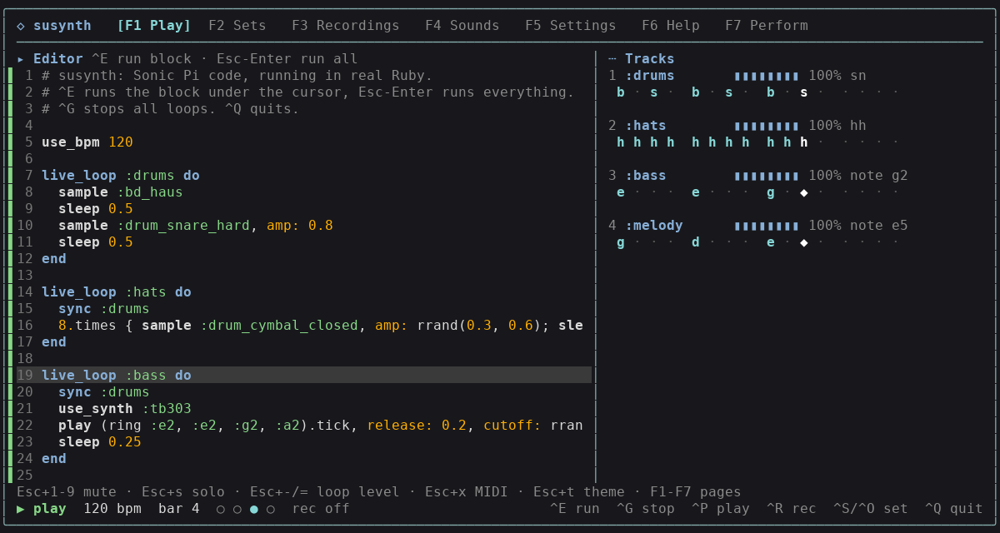
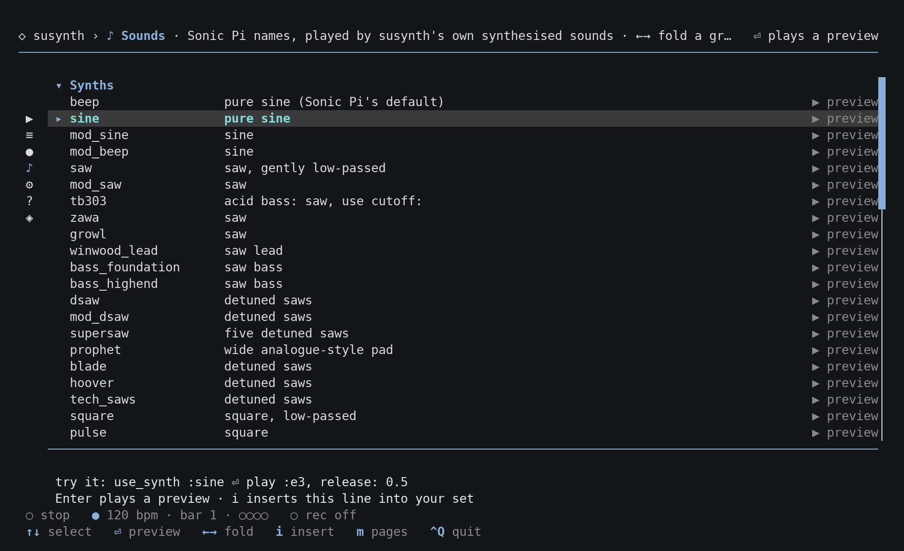

# susynth

A terminal instrument for live-coding music in **Sonic Pi's language**. You write
`live_loop`s in an editor pane, press `^E`, and hear the change on the loop's next
pass. One standalone Go binary: no cgo, no Ruby to install, no external player programs.

```ruby
use_bpm 120

live_loop :drums do
  sample :bd_haus
  sleep 0.5
  sample :drum_snare_hard, amp: 0.8
  sleep 0.5
end

live_loop :bass do
  sync :drums
  use_synth :tb303
  play (ring :e2, :e2, :g2, :a2).tick, release: 0.2, cutoff: rrand(70, 110)
  sleep 0.25
end
```



## Screenshots

| | |
|---|---|
|  **Play (F1):** four `live_loop`s running; the Tracks pane shows each loop's level, last sound and a one-bar step display. |  **An error in one loop:** a typo on line 33 stops `:melody` and is marked in red; the other loops keep playing. |
|  **First launch:** the editor opens at once while Ruby compiles in the background; code you run now starts when Ruby is ready. |  **Sounds (F4):** Sonic Pi synth, sample and effect names in folding groups; `Enter` previews, `i` inserts an example. |
|  **Settings (F5):** audio output, OSC, MIDI, samples folder, theme. (Taken with audio off, so it shows `none`.) |  **Help (F6):** keys and a Sonic Pi language reference. |

## How it works

```
  terminal UI (Go)  ──code──▶  live (Go middleman)  ──"run" / "advance to t"──▶  Ruby sandbox
        ▲                         │        ▲                                      (CRuby 3.4 in
        │ tracks, errors, puts    │        └──── timed notes, errors, puts ─────  WebAssembly)
        │                         ▼
        └──────────────── audio engine (Go) ──▶ sound card / WAV / MIDI / OSC
```

* **Real Ruby.** Your code runs in CRuby 3.4, compiled to WebAssembly and run by
  [wazero](https://github.com/tetratelabs/wazero), a pure-Go runtime. Everything Ruby can
  do works: methods, `define`, blocks, `each`/`map`, hashes, string interpolation, classes.
* **Sandboxed.** The Ruby side has no network and no file system. It can only make sound.
* **Sonic Pi's runtime, rewritten.** `internal/rubyvm/runtime.rb` implements Sonic Pi's
  API in Ruby: `live_loop`, `in_thread`, `sync`/`cue`, `play`, `sample`, `sleep`, `use_bpm`,
  `use_synth`, `with_fx`, synth and sample defaults, `ring`/`tick`/`look`, `chord`, `scale`,
  `spread`, `knit`, `line`, `range`, `rrand`/`choose`/`dice` (deterministic, as in Sonic Pi),
  `define`, `at`, `density`, `set`/`get`, `puts`. Each loop is a Ruby Fiber with its own
  virtual time; `sleep` hands control back to a scheduler that always runs the thread that is
  furthest behind, so timing is exact and never depends on the real clock.
* **The middleman** (`internal/live`) keeps Ruby's virtual time about 250 ms ahead of the
  audio, turns the notes Ruby plays into sample-accurate engine hits, and brings errors and
  `puts` back to the screen.
* **The audio engine** (`internal/engine`) starts every note on its exact sample and mixes,
  records, and sends MIDI/OSC as before.

Sonic Pi's synth, sample and effect **names** work, but the sounds are susynth's own
synthesised voices (no SuperCollider, no sample files): `:prophet` plays a supersaw,
`:bd_haus` plays the built-in kick, and so on. F4 Sounds lists every name. Effects map onto
susynth's filters, bit crusher, distortion, echo and reverb; effects with no equivalent are
skipped with a note. Put your own `.wav` files in the samples folder to use real samples
(`sample :mybank, 2`, `sample :kick`, or `sample "~/path/to/file.wav"`).

## Prerequisites

To **run** a prebuilt binary:

| What | Needed? | Details |
|---|---|---|
| Operating system | Yes | Linux (x86-64 or ARM64) or macOS (Intel or Apple Silicon). On Windows only `render`, `check` and `midi` work; the live editor needs a Unix terminal. |
| Terminal | Yes | UTF-8 with 256 colours (almost any modern terminal), at least 60 × 12; 120 × 32 or larger is comfortable. |
| Sound | Recommended | Linux: PulseAudio or PipeWire, or ALSA (`libasound.so.2`, installed on nearly every desktop). macOS: nothing extra. Without sound it runs silent and can still record. |
| Disk space | Yes | About 20 MB for the program, plus about 85 MB of cache the first time Ruby is compiled. |
| Ruby, SuperCollider, Sonic Pi | No | Ruby is built in. No other music software is needed. |
| Your own samples | Optional | `.wav` files (8/16/24/32-bit or float) in the samples folder. |
| MIDI device | Optional | Linux raw MIDI device (for example `/dev/snd/midiC1D0`) for live MIDI out. |
| SuperDirt | Optional | Only if you want to send notes to SuperCollider over OSC. |

To **build** from source:

| What | Needed? | Details |
|---|---|---|
| Go | Yes | 1.25 or newer. Dependencies are vendored, so no internet is needed. |
| C compiler | No | The build uses `CGO_ENABLED=0`. |
| make | Optional | For `make build`, `make dist` and `make test`; plain `go build` works too. |
| C compiler + cgo | Optional | Only for `go test -race`. |

## Quick start

```
make build                            # CGO_ENABLED=0 go build -o susynth ./cmd/susynth
./susynth                             # open the live editor
./susynth examples/first.rb
./susynth render -seconds 30 set.rb   # render a WAV, no sound device needed
./susynth midi -seconds 30 set.rb     # export a Standard MIDI File
./susynth check set.rb                # syntax check, then run 8 s silently to catch errors
./susynth samples                     # list loaded sample banks
./susynth devices                     # audio outputs and MIDI devices
```

**First launch:** Ruby is compiled to machine code the first time (about 10–15 s, cached in
`~/.cache/susynth/ruby`, roughly 85 MB). The editor opens at once and Ruby warms up in the
background; code you run before it is ready plays as soon as it is. Later launches start Ruby
in about a second.

Audio is built in (PulseAudio/PipeWire, ALSA, CoreAudio, WASAPI via oto), with a fallback to
`pw-cat`/`paplay`/`aplay`. With nothing, it runs silent and `^R` still records a WAV.

## Guide

### 1. Start it

Run `./susynth`. The editor opens with a starter set already in it. On the very first launch
the Tracks pane says *compiling Ruby (first run only)…*; you can read and edit while it
finishes, and anything you run in the meantime starts as soon as Ruby is ready.

The screen has four parts:

* **Editor** (left): your code. A green bar in the left margin marks lines that are running;
  a red bar marks a line with an error.
* **Tracks** (right): one row per running `live_loop`, with its number, level, the last sound
  it played, and a one-bar step display. The `◆` is where the bar is now.
* **Message row**: what just happened, errors, and `puts` output.
* **Transport bar** (bottom): playing or stopped, tempo, bar and beat, recording.

### 2. Play the starter set

Press `Esc` then `Enter` to run the whole buffer. Drums, hats, an acid bass and a melody
start together. Press `^G` to stop everything.

### 3. Write your first loop

Clear the starter text with `^A` then `Delete`, and type:

```ruby
live_loop :beat do
  sample :bd_haus
  sleep 1
end
```

Put the cursor anywhere inside the loop and press `^E`. A kick plays once a beat. Every
`live_loop` needs a name (`:beat`) and must `sleep` somewhere inside it.

### 4. Change it while it plays

Edit the loop and press `^E` again. The new version takes over on the loop's next pass, so
the music never stops:

```ruby
live_loop :beat do
  sample :bd_haus
  sleep 0.5
  sample :drum_snare_hard
  sleep 0.5
end
```

`^E` runs only the block the cursor is in (up to the nearest blank lines), so you can change
one loop without touching the others. `Esc Enter` runs the whole file again.

### 5. Copy, cut, paste and undo

* Hold **Shift** and use the arrow keys (or Home, End, PgUp, PgDn) to select; `^A` selects
  everything.
* `^C` copies and `^X` cuts the selection. With nothing selected they copy or cut the whole
  line the cursor is on. `^V` pastes.
* `Backspace` or `Delete` removes the selection. `^Z` undoes and `^Y` redoes.
* To paste code from another app (a browser, Sonic Pi, a text file), use your terminal's own
  paste: `Ctrl+Shift+V` on most Linux terminals, `Cmd+V` on macOS. It arrives as one block,
  indentation intact. To start from an empty editor, press `^A` then `Delete` first.
* What you copy also goes to the system clipboard in terminals that support it (kitty,
  WezTerm, iTerm2, Alacritty, foot, Windows Terminal and others). Where it isn't, select
  with the mouse and use the terminal's copy.

A handy live move: duplicate a loop with `^C` `^V`, rename the copy, change it and press `^E`.

### 6. Add more loops and keep them in time

Separate loops with a blank line. Use `sync` so a new loop starts on the beat of another:

```ruby
use_bpm 120

live_loop :beat do
  sample :bd_haus
  sleep 1
end

live_loop :bass do
  sync :beat
  use_synth :tb303
  play (ring :e2, :g2, :a2, :g2).tick, release: 0.3, cutoff: 90
  sleep 1
end
```

`use_bpm` sets the tempo (Sonic Pi starts at 60). `(ring …).tick` steps through the notes,
one per pass.

### 7. Add effects

Wrap sounds in `with_fx`:

```ruby
live_loop :keys do
  sync :beat
  use_synth :prophet
  with_fx :reverb, mix: 0.5 do
    play chord(:e3, :minor), release: 2, amp: 0.5
  end
  sleep 4
end
```

Available effects: `reverb`, `echo`, `lpf`, `hpf`, `bitcrusher`, `distortion`, `level` and
`pan` (plus a few aliases). F4 Sounds lists them all.

### 8. Find sounds

Press `F4` for the Sounds page. Groups fold open and shut with `←` / `→`. Highlight a synth
or sample and press `Enter` to hear it, or `i` to insert an example into your set. `F1`
returns to the editor.

### 9. Use your own samples

Put `.wav` files in the samples folder (shown on `F5` Settings; by default
`~/.local/share/susynth/samples`):

* a folder `samples/kit/` becomes `sample :kit, 0`, `sample :kit, 1`, …
* a file anywhere in there, `kick.wav`, can also be played as `sample :kick`
* or give a path: `sample "~/Music/loop.wav"`

On F5, highlight *Samples* and press `Enter` to reload after adding files.

### 10. Mix while you play

* `Esc` then a number mutes or unmutes that track (numbers are in the Tracks pane).
* `Esc s` then a number solos it; `Esc s 0` clears solo.
* With the cursor inside a loop, `Esc -` and `Esc =` lower or raise its level.

### 11. When something goes wrong

* **Syntax error:** nothing runs; a red row names the line. Fix it and press `^E` again.
* **Error inside a loop** (a typo, a wrong name): that loop stops, the others keep playing.
* **A loop with no `sleep`:** Ruby freezes; susynth restarts it within about 2 seconds and every
  loop stops. Add a `sleep` and run again.
* `puts` anything to see it on the message row: `puts "bar #{tick}"`.
* `^L` clears the error rows.

### 12. Save, record and export

* `^S` saves the set (as a `.rb` file); `^O` loads one. `F2` Sets lists them.
* `^R` starts and stops recording what you hear to a WAV file; `F3` Recordings lists them.
* `Esc x` exports a MIDI file. It runs your code silently in a second sandbox, so the music
  keeps playing.
* Without the editor: `./susynth render -seconds 60 set.rb` writes a WAV and
  `./susynth midi -seconds 60 set.rb` writes a MIDI file.

### 13. Perform a set list

On `F2` Sets, highlight a set and press `a` to add it to the set list. On `F7` Perform,
reorder with `[` / `]` and press `Enter` to go live with a set. During a show, `Esc n` and
`Esc p` move to the next and previous set.

### Where things are kept

| What | Linux / macOS default | Change with |
|---|---|---|
| Sets, recordings, samples | `~/.local/share/susynth/` | `SUSYNTH_DATA` |
| Settings, set list | `~/.config/susynth/` (macOS: `~/Library/Application Support/susynth/`) | `SUSYNTH_CONFIG` |
| Compiled Ruby cache | `~/.cache/susynth/ruby` (macOS: `~/Library/Caches/susynth/ruby`) | `SUSYNTH_CACHE` |

Deleting the cache is safe; Ruby is compiled again on the next launch.

## Keys

| key | action |
|---|---|
| `^E` | run the block under the cursor (top-level statements up to a blank line) |
| `Esc Enter` | run the whole buffer (Sonic Pi's Run) |
| `^G` | stop every loop and thread (Sonic Pi's Stop) |
| `^P` | stop, or run the whole buffer again |
| `^R` | record a WAV · `^S` / `^O` save / load a set (`.rb`) |
| `Shift` + arrows | select text (also with Home, End, PgUp, PgDn) · `^A` selects everything |
| `^C` / `^X` / `^V` | copy / cut / paste the selection (with nothing selected: the whole line) |
| `Backspace` / `Delete` | delete the selection, or one character |
| `^Z` / `^Y` | undo / redo · `^K` deletes the current line |
| `Esc 1-9` · `Esc s n` | mute / solo a track (numbers in the Tracks pane) |
| `Esc -` / `Esc =` | level of the live_loop the cursor is in |
| `Esc x` | export MIDI (runs silently in a second sandbox; the music keeps playing) |
| `F1`–`F7` | Play, Sets, Recordings, Sounds, Settings, Help, Perform |

As in Sonic Pi: re-running a `live_loop` swaps its body in on its next pass; a loop you
delete from the text keeps playing until `^G`; an error inside a loop stops that loop only.
A loop that never sleeps would freeze Ruby, so susynth restarts the sandbox after 2 seconds
and stops everything.

## Build

Needs Go 1.25+. Dependencies are vendored, so it builds offline.

```
make dist     # linux amd64/arm64, macOS amd64/arm64, windows amd64 -> dist/
make test     # vet + tests (the race detector needs CGO_ENABLED=1)
```

Binaries are about 15 MB, most of which is the compressed Ruby (`internal/rubyvm/ruby.wasm.gz`,
provenance and licences in `internal/rubyvm/LICENSES`).

## Libraries

* [wazero](https://github.com/tetratelabs/wazero) v1.11 (Apache-2.0): runs the Ruby sandbox.
* [ruby.wasm](https://github.com/ruby/ruby.wasm) 2.7.1 build of CRuby 3.4.1 (Ruby/BSD; MIT).
* [oto](https://github.com/ebitengine/oto) v3.5.1 for audio output, with purego, jfreymuth/pulse
  and x/sys.

The sandbox blocked the Go module proxy and checksum database, so modules were fetched from
GitHub with checksum verification off; run `go mod verify` on a networked machine.

## Verification status

Verified in a sandbox: unit tests (with `-race`), Sonic Pi features through real Ruby (loops,
sync, ring/tick, define, hashes, interpolation, chords, spread, effects, error line numbers,
recovery from a loop that never sleeps), Ruby → engine → audio rendered offline and checked
for beats, live redefinition in real time, the editor through a pty including a first launch
with an empty cache, rendered levels (no clipping), MIDI export, cross-compiles for five targets.

**Not verified:** a real sound card, macOS, Windows, a real MIDI device or SuperDirt, and how
close each Sonic Pi synth sounds to the original (it won't sound the same).

## Known gaps

* No `control` (changing a note while it plays), no `sample` `start:`/`finish:`/`beat_stretch:`,
  and only the effects listed on F4. MIDI/OSC calls in code are skipped; use F5 Settings.
* Ruby's own `Thread` isn't available; Sonic Pi's `in_thread` and `live_loop` are.
